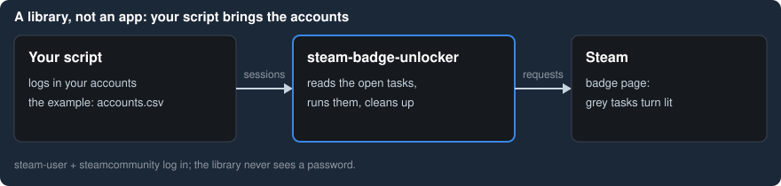
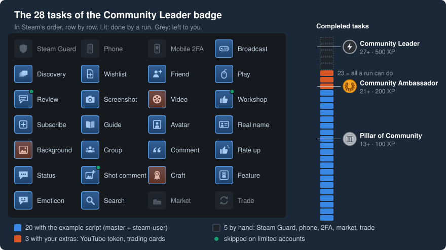

# Steam Community Badge Unlocker for Node.js

[](https://npmjs.com/package/steam-badge-unlocker)
[](https://github.com/HenkerX64/node-steam-badge-unlocker/blob/master/LICENSE)

Completes up to 23 of the 28 tasks of the Steam **Community Leader** badge on your Steam accounts, one account
after another. A Node.js library that extends [steamcommunity](https://www.npmjs.com/package/steamcommunity): it
runs the tasks on the logged-in session of each account, from your own bot or from the example script.

> **Note:** Users with one or two accounts are encouraged to complete these tasks manually for a better Steam
> experience.



## What it solves

The Community Leader badge ([badge 2](https://steamcommunity.com/my/badges/2)) asks every account for 28 small tasks: join a group, post a screenshot,
review a game, comment on a friend's profile and more. Steam calls them tasks; the log and the code call them
quests. The library does up to 23 of them per account and deletes most of what it posts again. One of your
accounts, the master, is the friend that the friend tasks need.

Steam gives the badge in three levels:

|                                                                                                                                                                                            | Level                | Completed tasks | XP  |
|:------------------------------------------------------------------------------------------------------------------------------------------------------------------------------------------:|----------------------|-----------------|-----|
|                        | Pillar of Community  | 13+             | 100 |
|                   | Community Ambassador | 21+             | 200 |
|  | Community Leader     | 27+             | 500 |

Below Steam level 10, every 100 XP is one Steam level, so the badge is worth up to 5 levels.



On a full account (at least 5 USD spent on Steam), the example script alone does the 20 blue tasks: Pillar of
Community. A YouTube token and a set of trading cards add the 3 orange ones: 23, Community Ambassador. Community
Leader needs 27, so also 4 of the 5 grey tasks, done by hand. A limited account skips three tasks and has no
Market, so it stops at Community Ambassador. All 28 with Steam's icons and what each one needs:
[tasks](docs/tasks.md).

## How to use it

With Node.js 14 or newer and two or more Steam accounts with a mobile authenticator:

1. Install the library and the packages the example script uses:

   ```bash
   npm install steam-badge-unlocker steamcommunity steam-user steam-totp
   ```

2. Copy [`run-community-leader.js`](examples/run-community-leader.js) and the folder `utils/` from
   `node_modules/steam-badge-unlocker/examples/` into your folder.
3. Write `accounts.csv`: the line `username,password,shared_secret`, then one line per account. The first
   account is the master: a full account whose newest screenshot is public. All others are bots.
4. Start it:

   ```bash
   node run-community-leader.js accounts.csv
   ```

Each bot takes about 6 minutes, most of it PlayGame. Run it again any time: only the open tasks run. Step by
step, with what the log means: [Getting started](docs/getting-started.md).

**Already logging in your accounts with `steamcommunity`?** Pass the sessions to the library. Here `master` and
`bot` hold the logged-in `steamcommunity` instance (`community`) and `steam-user` client (`user`) of each
account:

```javascript
const SteamBadgeUnlocker = require('steam-badge-unlocker');

async function runTasks(master, bot) {
	const unlocker = new SteamBadgeUnlocker(bot.community);
	const leader = unlocker.createCommunityLeader({
		masterInstance: master.community,
		steamUser: bot.user,
		forceAddFriend: true,
		forceRemoveFriend: true,
	});

	try {
		await leader.start();
	} finally {
		await leader.finish();
	}
}
```

More: [How to add it to an existing project](docs/how-to/add-to-an-existing-project.md). For
[quer/the-steam-awards](https://github.com/quer/the-steam-awards) there is a ready module,
[`examples/the-steam-awards-module.js`](examples/the-steam-awards-module.js).

**Before you run it:**

- Some changes stay on the accounts: the avatar, the profile background, votes, a chat message; crafting uses
  up a set of trading cards. [What stays](docs/how-it-works.md#what-stays-on-the-accounts).
- Steam limits a machine: these docs assume about 10 accounts. [Steam limits](docs/how-it-works.md#steam-limits).

## Learn more

| I want to…                                                                                                               | Read                                                                      |
|--------------------------------------------------------------------------------------------------------------------------|---------------------------------------------------------------------------|
| run it for the first time, step by step                                                                                  | [Getting started](docs/getting-started.md)                                |
| run all my accounts, get the YouTube token, skip a task, react to `429`                                                  | [how-to guides](docs/how-to/README.md)                                    |
| know what a log line or an error code means                                                                              | [FAQ](docs/faq.md), [error codes](docs/reference/error-codes.md)          |
| see every task with Steam's name and icon                                                                                | [tasks](docs/tasks.md)                                                    |
| change what the tasks use: game, group, texts, play time                                                                 | [options](docs/reference/options.md)                                      |
| check the supported versions of Node.js, steamcommunity and steam-user                                                   | [requirements](docs/reference/requirements.md)                            |
| understand the master, the order of the tasks and the time a run takes                                                   | [How it works](docs/how-it-works.md)                                      |
| see every method and type                                                                                                | [`index.d.ts`](index.d.ts)                                                |
| know what it adds to my steamcommunity bot                                                                               | [What this adds over steamcommunity](#what-this-adds-over-steamcommunity) |

The docs and the examples also ship in the npm package, e.g.
`node_modules/steam-badge-unlocker/docs/getting-started.md`.

## What this adds over steamcommunity

For developers: the library does not replace [steamcommunity](https://www.npmjs.com/package/steamcommunity).
Besides the task runner, it adds Steam actions that `steamcommunity` and
[steam-user](https://www.npmjs.com/package/steam-user) lack, on the same web session: uploading screenshots,
crafting badges, setting profile backgrounds without a Steam client, reading the task progress and more. Every
method is declared in [`index.d.ts`](index.d.ts); everything declared there is public API under semver,
except the few members it names.

Trade is not automated; it would
need [steam-tradeoffer-manager](https://www.npmjs.com/package/steam-tradeoffer-manager).

## Support

Report issues on the [GitHub issue tracker](https://github.com/HenkerX64/node-steam-badge-unlocker/issues).

## License

MIT License
