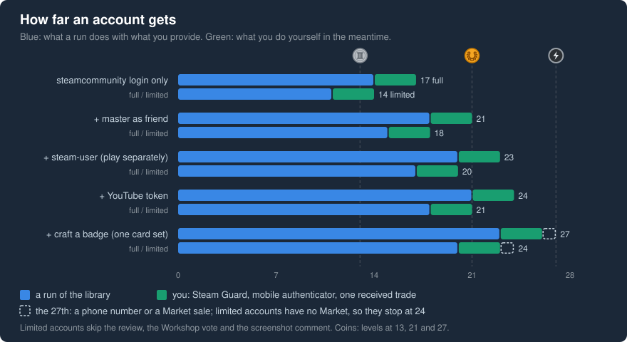

# FAQ

Short answers to what comes up after the first run. Setup step by step: [Getting started](getting-started.md).
Every task: [tasks](tasks.md).

## Before a run

### How many tasks will an account complete?

It depends on what the run gives the account, on the account itself and on what you do by hand:



| You provide                                                          | Full account | Limited account |
|----------------------------------------------------------------------|--------------|-----------------|
| a logged-in `steamcommunity`                                         | 14           | 11              |
| + a friend (master account) and Steam Guard enabled                  | 18           | 15              |
| + `steamUser`                                                        | 20           | 17              |
| + YouTube token                                                      | 21           | 18              |
| + craft a badge (one full card set; it drops the profile background) | 23           | 20              |

- `examples/run-community-leader.js` gives every bot the first three rows: the login, the master as friend
  and `steamUser`. Its login needs a mobile authenticator, so Steam Guard is on.
- The tasks you do by hand count on top, green in the chart. To log in with the example script, a bot needs
  Steam Guard and the mobile authenticator anyway; one received trade makes 3. Community Leader needs 27, so
  one more: a phone number or a Market sale.
- PlayGame holds each bot for 5:30.
- The counts assume that each task succeeds with its default target: a live broadcast exists, and the account
  can review Counter-Strike 2 (app 730).
- FeatureBadgeOnProfile needs the badge unlocked, which Steam does after 13 completed tasks; without a friend
  and `steamUser` a new account usually completes it in a second run.

### What changes for a limited account?

A limited account has spent less than 5 USD on Steam. For this library it:

- cannot send friend invites, only accept them, so the master must be a full account;
- skips PostCommentOnFriendsScreenshot, RecommendGame and RateWorkshopItem;
- cannot send trade offers, give items away or use the Market, but can accept an offer that only gives it
  items. Such a gift counts as a trade, and a gifted card set lets it craft;
- gets no card drops of its own.

So a limited account stops at 24 tasks, Community Ambassador.

VAC-banned accounts skip RateWorkshopItem too.

### How many accounts can I run, and how long does it take?

These docs are written for about 10 accounts per machine, the number ArchiSteamFarm suggests
([ASF FAQ](https://github.com/JustArchiNET/ArchiSteamFarm/wiki/FAQ#how-many-bots-can-i-run-with-asf)). Each bot
takes about 6 minutes, most of it PlayGame (330 seconds), and the bots run one after another: 7 bots take 40
minutes or more. Timeline: [How it works](how-it-works.md#time).

### My accounts already play in ArchiSteamFarm. Does PlayGame clash?

Yes. Steam lets only one session per account play at a time, and PlayGame stops a game that another session
plays ([steam-user: playingState](https://github.com/DoctorMcKay/node-steam-user#playingstate)). Leave
`steamUser` out for those accounts; in `examples/run-community-leader.js`, delete the line
`steamUser: bot.user,`. PlayGame and UseEmoticonInChat are then skipped with `SKIP_MISSING_STEAM_USER`.

## Reading the log

### What does a log line say?

The example script writes the time and the account name, then a key and a value:

```
- { friendsScreenshotFileId: '3832055065' }
- { openQuests: 9 }
AddItemToWishlist OK
PostVideo SKIP_MISSING_YOUTUBE_ACCESS_TOKEN
ViewBroadcast false
RecommendGame 429
- { openQuests: 8, solvedQuests: 1 }
```

After a task name:

| Value                    | Meaning                                                                                                                      |
|--------------------------|------------------------------------------------------------------------------------------------------------------------------|
| `OK`                     | the task's requests went through                                                                                             |
| `SKIP_…`                 | something the task needs was not given; no request was sent                                                                  |
| `false`                  | nothing to do (no live broadcast, no badge ready to craft, no YouTube video) or Steam said no                                |
| `429`                    | too many requests from your IP: [wait](#what-do-i-do-when-tasks-log-429-or-ratelimitexceeded)                                |
| another code in capitals | see [error codes](reference/error-codes.md)                                                                                  |
| other text               | a Steam or `steamcommunity` message: `RateLimitExceeded` means wait; `Not Logged In` means the session expired, log in again |

The other lines:

| Line                                                | Meaning                                                                                                                         |
|-----------------------------------------------------|---------------------------------------------------------------------------------------------------------------------------------|
| `- { friendsScreenshotFileId: '…' }`                | the master's newest screenshot, read once for all bots. `null`: the master has none, and the screenshot comment fails           |
| `- { openQuests: N }`                               | open tasks before the run; `0` means the bot is done                                                                            |
| `- { openQuests: N, solvedQuests: M }`              | open tasks after the run, read from Steam again; this is what counts                                                            |
| `error not able to get badge progress`              | the badge page showed no tasks, e.g. the profile is not set up; the `{ openQuests: 0 }` after it means "unreadable", not "done" |
| `login <account>: <reason>`                         | the bot could not log in and was skipped, see [below](#why-is-an-account-skipped-at-login)                                      |
| `start <message>`                                   | `start()` failed for this bot; the script goes on with the next one                                                             |
| `stopped Steam blocks web requests from this IP: …` | see [ACCESS_DENIED](#the-run-stopped-with-access_denied-what-now)                                                               |

`OK` means the requests succeeded, not that Steam counted the task: compare `openQuests` before and after. A
failed cleanup (deleting a comment, leaving the group, …) is not logged; check the account when it matters.

Without the example script, the default logger writes `DD-MM-YYYY HH:MM - <SteamID64> - <key> <value>`; pass
`log` to use your own, see [options](reference/options.md#how-the-run-works).

### Why is a task missing from the log?

`start()` logs only the tasks it runs:

- done tasks never run, and neither do Steam Guard, the phone, the mobile authenticator and the Market;
- PostCommentOnFriendsPage runs only when Steam Guard is enabled (the SetupSteamGuard task is done);
- limited accounts skip three tasks, VAC-banned accounts the Workshop vote; Trade runs only on full accounts
  without a trade ban and logs `false`;
- after `ACCESS_DENIED` no further task runs.

## When Steam pushes back

### What do I do when tasks log 429 or RateLimitExceeded?

Steam limits a burst of requests or logins. What to do:
[How to react to 429 or a blocked IP](how-to/handle-429-or-a-blocked-ip.md#quests-log-429-or-ratelimitexceeded).

### The run stopped with ACCESS_DENIED. What now?

Steam's CDN blocks web requests from your IP for now. What to do:
[How to react to 429 or a blocked IP](how-to/handle-429-or-a-blocked-ip.md#the-run-stops-with-access_denied).

### Why does PostVideo log false or INVALID_YOUTUBE_ACCESS_TOKEN?

The YouTube token expired (it lasts about one hour), or the YouTube account has no public or unlisted video.
With an expired token PostVideo logs `false`; with `youtubeId` set it logs `INVALID_YOUTUBE_ACCESS_TOKEN`.
Copy a fresh token and run again for those bots: [How to get the YouTube cookie](how-to/get-the-youtube-cookie.md).

### Why is an account skipped at login?

`examples/utils/login-accounts.js` never asks you for a code, so an account that needs one is skipped. When the
master cannot log in, the script stops.

- `Steam Guard code needed (email)`: the account uses email Steam Guard. Give it a mobile authenticator and put
  its `shared_secret` in the CSV file, or log it in once yourself and store its refresh token, see
  [How to run the quests for all your accounts](how-to/run-all-your-accounts.md#handle-login-problems).
- `Steam Guard code needed (authenticator)`: the `shared_secret` is missing or wrong.
- another Steam error on an account that logged in before: its stored token failed. Delete its entry in
  `accounts.csv.tokens.json`; the next run logs in with the password.

## After a run

### Can I run it again?

Yes, any time. `start()` reads the open tasks first and runs only those: PostVideo with a fresh token, tasks
that logged `429`, FeatureBadgeOnProfile once 13 tasks are done. After `ACCESS_DENIED`, wait first.

### How do I complete the master's own tasks?

The master runs no tasks in its own run. Put another full account in the first row, move the old master down
among the bots, and run again.

### Why is my bot still not Community Leader?

A run does at most 23 tasks. The other 4 of the 27 are yours: Steam Guard, the mobile authenticator, a phone
number, a Market sale or a trade. A limited account has no Market and skips three tasks, so it stops at 24. Which ones
are still open: [How to check quest progress](how-to/check-quest-progress.md).
