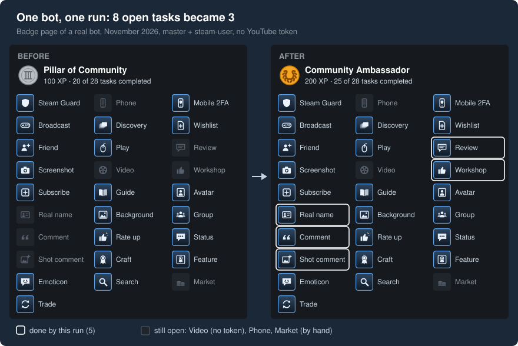

# Getting started

In this tutorial you run the Community Leader tasks for one bot account, with a second account of yours as its
master. You use the example script that ships with the package and write no code. At the end the bot has
completed its first tasks, and you have followed them from the log to the badge page. The run takes a little
over 6 minutes, most of it waiting.

## Before you start

You need Node.js 14 or newer (`node --version` shows it) and two Steam accounts that you own:

- **the master**: a full account, one that has spent at least 5 USD on Steam. During the run it is the bot's
  friend.
- **the bot**: the account that runs the tasks.

Both accounts need:

- a Steam profile that has been set up once: log in on steamcommunity.com and finish "Set up Steam Profile";
- Steam Guard with a mobile authenticator, and its `shared_secret`, e.g. from the `.maFile` of Steam Desktop
  Authenticator.

The master also needs:

- a public screenshot as its newest screenshot: upload a screenshot on the master and make it public;
- comments from friends allowed on its profile and screenshots: Edit Profile → Privacy Settings → Comments.

Why there is a master: [How it works](how-it-works.md#the-master-and-the-bots).

## Step 1: Create a project folder

```bash
mkdir badge-run
cd badge-run
npm init -y
```

npm writes a `package.json` into the new folder, so the next step installs into this folder.

## Step 2: Install the packages

```bash
npm install steam-badge-unlocker steamcommunity steam-user steam-totp
```

`steamcommunity` talks to the Steam website, `steam-user` logs in like the Steam client and plays the game,
`steam-totp` makes the login codes from `shared_secret`. npm reports the added packages, and a `node_modules`
folder appears.

## Step 3: Copy the example script

```bash
cp node_modules/steam-badge-unlocker/examples/run-community-leader.js .
mkdir utils
cp node_modules/steam-badge-unlocker/examples/utils/login-accounts.js utils/
```

On Windows, copy the two files with the file manager. Your folder now looks like this:

```
badge-run/
├── node_modules/
├── package-lock.json
├── package.json
├── run-community-leader.js
└── utils/
    └── login-accounts.js
```

## Step 4: Write the accounts file

Create the file `accounts.csv` in `badge-run` with three lines: the column names, the master, the bot.

```csv
username,password,shared_secret
my_master,master_password,MastersSharedSecret=
my_bot,bot_password,BotsSharedSecret=
```

Put in the real login names, passwords and `shared_secret` values. The master stays in the first row. The file
holds your passwords: keep it private.

## Step 5: Run the tasks

```bash
node run-community-leader.js accounts.csv
```

The script logs in the master, waits 10 seconds and logs in the bot. Then the first lines appear. Notice the
new file `accounts.csv.tokens.json` next to `accounts.csv`: the script keeps login tokens there, so later runs
log in without password and code. Keep it as private as `accounts.csv`.

Somewhere in the middle the log pauses for about 6 minutes: PlayGame plays a game for 330 seconds. Let it run.
When the last line has appeared, the script logs both accounts off and you are back at the prompt.

## Step 6: Read the output

Every line starts with the time and the account name. A bot with 8 open tasks, run without a YouTube token in
November 2026, logged these lines:

```
<time> my_bot - { friendsScreenshotFileId: '3832055065' }
<time> my_bot - { openQuests: 8 }
<time> my_bot PostVideo SKIP_MISSING_YOUTUBE_ACCESS_TOKEN
<time> my_bot SetupCommunityRealName OK
<time> my_bot AddFriendToFriendsList OK
<time> my_bot PostCommentOnFriendsPage OK
<time> my_bot RecommendGame OK
<time> my_bot PostCommentOnFriendsScreenshot OK
<time> my_bot RateWorkshopItem OK
<time> my_bot - { openQuests: 3, solvedQuests: 5 }
```

Your log has its own tasks and numbers; a new bot has many more open tasks and so more lines. This bot had
PlayGame done already, so its log has no 6-minute pause; on a bot with PlayGame open, `PlayGame OK` appears
after the pause.

- The first `openQuests` counts the tasks the bot still had open before the run.
- Each task logs its name and a value. `OK` means its requests went through; `SKIP_…` that something it needs
  was not given, here the YouTube token. Every value: [FAQ](faq.md#what-does-a-log-line-say).
- The last line counts again. `solvedQuests` is what Steam counted for this run.

`AddFriendToFriendsList OK` adds nothing to the count: the bot had that task already, and the script adds the
master in every run because the other friend tasks need the friendship.

## Step 7: See it on the badge page

Open the bot's badge page, <https://steamcommunity.com/my/badges/2>, logged in as the bot. Steam shows the same
result as the log: five grey tasks turned lit, and the bot moved up a level.



Three tasks stayed grey, the `openQuests: 3` of the last log line: Post a video, because the run had no YouTube
token, and Add a phone number and Try out the Community Market, which the library leaves to you. Steam Guard,
the mobile app and the trade were lit before the run: the owner had done them by hand. Steam's names and icons
of all 28 tasks: [tasks](tasks.md).

## If something goes wrong

- `login … Steam Guard code needed (email)`: the account uses email Steam Guard and was skipped, see
  [FAQ](faq.md#why-is-an-account-skipped-at-login).
- `login … Steam Guard code needed (authenticator)`: the `shared_secret` of that account is missing or wrong.
- `{ friendsScreenshotFileId: null }`: the master has no screenshot, so the screenshot comment fails. Upload one,
  make it public and run again.
- `error not able to get badge progress`, then `{ openQuests: 0 }`: the badge page showed no tasks, e.g. the
  profile is not set up. Here 0 means "unreadable", not "done".
- `429` or `stopped Steam blocks web requests`: wait before the next run, see
  [How to react to 429 or a blocked IP](how-to/handle-429-or-a-blocked-ip.md).

## What you did

You ran the tasks for one bot and followed the result from the log to the badge page. The master was the bot's
friend only for the run. Running again is safe: only the tasks that are still open run.

## Next

- Run all your accounts: [How to run the quests for all your accounts](how-to/run-all-your-accounts.md).
- Add PostVideo: [How to get the YouTube cookie](how-to/get-the-youtube-cookie.md).
- See which tasks are still open: [How to check quest progress](how-to/check-quest-progress.md).
- Change what the tasks use, e.g. the game to review: [options](reference/options.md).
- Understand the run: [How it works](how-it-works.md).
