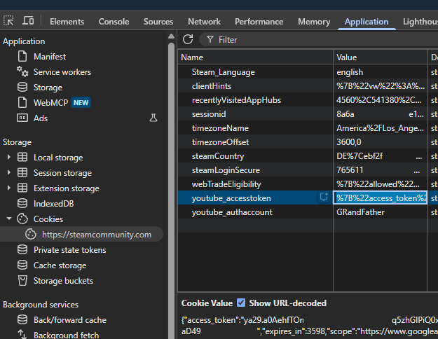

# Getting started

`steam-badge-unlocker` completes the quests of the Steam Community Leader badge for bot accounts. It never
handles credentials: it works on `steamcommunity` instances that are already logged in and, for two quests,
on a `steam-user` client. This page covers what you need, how to run it, where every piece of data comes
from and how to read a run. The quests themselves: [task catalog](tasks.md).

## What you need

- Node.js `>=10` for the package, `>=14` for `steam-user` 5 and the example scripts; `steamcommunity`
  `>=3.43.1` (tested with 3.50.3); `steam-user` `>=5.0.0` for PlayGame and UseEmoticonInChat.
- Several Steam accounts. The first one is the **master**: the friend of all others. It runs no quests in
  that run; to complete its own quests, start another run with a different account in the first row. About 10
  accounts is the setup these docs are written for (see [Steam limits](#steam-limits)).
- For every account: a Steam Community profile that has been set up once (log in on steamcommunity.com and
  finish "Set up Steam Profile", or call `community.setupProfile()` of `steamcommunity`), and Steam Guard
  enabled: `start()` runs PostCommentOnFriendsPage only when the SetupSteamGuard quest is completed, because
  Steam allows profile comments only with Steam Guard. For `examples/run-community-leader.js` that means a mobile
  authenticator; email Steam Guard works there only with a stored refresh token (see below).
- For the master: a full account (limited accounts cannot send friend invites), and friends must be allowed to
  comment on its profile and screenshots (Edit Profile → Privacy Settings → Comments). Upload a screenshot on
  the master and make it public: `start()` takes the id of the master's newest screenshot, also when that one
  is private, and logs
  `{friendsScreenshotFileId: null}` when the master has none; PostCommentOnFriendsScreenshot then fails with
  `MISSING_FILE_ID`. The id, also `null`, is read once per process for all bots: after uploading the screenshot,
  start the process again.

## Run it with the example script

The fastest start for a new project: [`examples/run-community-leader.js`](../examples/run-community-leader.js) with
[`examples/utils/login-accounts.js`](../examples/utils/login-accounts.js).

1. Install the libraries:

   ```bash
   npm install steam-badge-unlocker steamcommunity steam-user steam-totp
   ```

2. Copy `examples/run-community-leader.js` and the folder `examples/utils/` from
   `node_modules/steam-badge-unlocker/examples/` into your project.
3. Write the accounts into a CSV file, master first, e.g. `accounts.csv` next to `run-community-leader.js` (any
   path works, it is the first argument). The first line names the columns; more columns are ignored; values
   must not contain commas:

   ```csv
   username,password,shared_secret
   master_account,master_password,base64SharedSecretOfTheMaster=
   bot_account_1,bot_password_1,base64SharedSecretOfBot1=
   ```

4. Run it, optionally with fewer accounts than the file has:

   ```bash
   node run-community-leader.js accounts.csv
   node run-community-leader.js accounts.csv 4   # the master and 3 bots
   YT_ACCESS_TOKEN=<youtube_accesstoken cookie> node run-community-leader.js accounts.csv
   ```

The script logs in the master, then every bot 10 seconds apart, runs `start()` and `finish()` for each bot
with the master as friend, and logs everything with the account name. With 8 accounts in the file, 7 run
the quests. Each bot stays logged in while its quests run; PlayGame alone keeps it busy for `playSeconds`
(330 by default). If the master cannot log in, the script stops.

`login-accounts.js` logs in without asking you: with the `shared_secret` it generates the mobile authenticator
code, and after the first login it keeps a `steam-user` refresh token per account in
`accounts.csv.tokens.json` (file mode 600) for the next logins; a token that expires within the next hour is not used. When a
token login fails, the account is skipped with the Steam error: delete its entry to log in with the password
again. An account that asks for an email code
is skipped: give it a mobile authenticator, or log it in once with `steam-user` yourself (its `refreshToken`
event hands you the token) and store the token in that file as `{"<username>": "<refreshToken>"}`. Keep both
files out of version control.

## Add it to a project that already uses steamcommunity

```bash
npm install steam-badge-unlocker
```

```javascript
const SteamBadgeUnlocker = require('steam-badge-unlocker');

// masterCommunity and each bot.community: logged-in steamcommunity instances
async function runQuests(masterCommunity, bots) {
	for (const bot of bots) {
		const leader = new SteamBadgeUnlocker(bot.community).createCommunityLeader({
			masterInstance: masterCommunity,
			steamUser: bot.user, // only when your project runs steam-user
			forceAddFriend: true,
			forceRemoveFriend: true,
		});
		await leader.start().catch(console.error);
		await leader.finish();
	}
}
```

- Create each `SteamBadgeUnlocker` after `community.setCookies(cookies)`: the constructor reads the SteamID
  and session id once. After a new login create a new one.
- `forceAddFriend` adds the master even when the AddFriendToFriendsList quest is already done (as long as any
  quest is open), because the other friend quests need the friendship; `forceRemoveFriend` removes it again in
  `finish()`. Without a master, `forceRemoveFriend` removes `friendSteamId`, also a friend you had before.
- Give every account its own `steamcommunity` instance. The master instance can be shared by all leaders.

`steam-user` is the easiest way to get logged-in instances: it keeps the session alive and hands web cookies
to `steamcommunity`. `steamcommunity.login()` works as well, but then PlayGame and UseEmoticonInChat are
skipped. The minimum per account:

```javascript
const SteamUser = require('steam-user');
const SteamCommunity = require('steamcommunity');

// details: {accountName, password, twoFactorCode} or {refreshToken}
function logIn(details) {
	return new Promise((resolve, reject) => {
		const user = new SteamUser();
		user.once('error', reject);
		user.once('webSession', (sessionId, cookies) => {
			user.removeListener('error', reject);
			user.on('error', error => console.error(error.message));
			const community = new SteamCommunity();
			community.setCookies(cookies);
			resolve({community, user});
		});
		user.logOn(details);
	});
}
```

Call `user.logOff()` for every account at the end.

### With quer/the-steam-awards

[`examples/the-steam-awards-module.js`](../examples/the-steam-awards-module.js) is a module for
[quer/the-steam-awards](https://github.com/quer/the-steam-awards). Copy it to `modules/CommunityBadge.js`,
add `modules.push('CommunityBadge');` to `main.js` and install `steam-badge-unlocker` and `steamcommunity`
in that project. The first bot of its account list becomes the master; every following bot runs the quests
with it, using the core's web cookies (`options.webCookie`) and its client as `steamUser`. The module expects
the core's default RunningMode Single: one account after another in one process. The core logs the next
account in right away; with many accounts set `RunningMode.DelayBetweenAccountModes` in its `lib/Settings.js`
to pace the logins (milliseconds, e.g. `10000`). PostVideo is off there; add `youtubeCookies`
to its `createCommunityLeader` options to turn it on.

## Where the data comes from

| Data | Where to get it | Used for |
|---|---|---|
| `username`, `password` | your accounts | login |
| `shared_secret` | the Steam Mobile Authenticator data of the account, e.g. the `.maFile` of Steam Desktop Authenticator or your own authenticator export | `login-accounts.js` generates the login code with `steam-totp`; without it an account that asks for a code is skipped |
| refresh token | written by `login-accounts.js` after the first login | later logins without password |
| master | one of your accounts, first row of the CSV | friend quests through `masterInstance` |
| `friendSteamId` | SteamID64 (17 digits) of a friend, from `steamcommunity.com/profiles/<id>`; for a custom URL `steamcommunity.com/id/<name>` open `steamcommunity.com/id/<name>/?xml=1` and take `steamID64` | friend quests without a master |
| `friendsScreenshotFileId` | the `id` in the URL of the friend's public screenshot, `steamcommunity.com/sharedfiles/filedetails/?id=<id>` | screenshot quests without a master; with a master it is read automatically |
| `youtubeCookies` | browser cookies after linking YouTube, see [YouTube cookies](#youtube-cookies-for-postvideo) | PostVideo |
| trading cards | one full set of cards of any game in the account's inventory | CraftGameBadge, and a background it drops for SetProfileBackground |
| Web API key | not needed: progress is read from the badge page. If the account already has a key (<https://steamcommunity.com/dev/apikey>), the package finds it on its own (`fetchBadgesWithApiKey`, default `true`). `steamcommunity` 3.48 and later only read an existing key; 3.43–3.47 register one for `localhost` when the account has none, so set `fetchBadgesWithApiKey: false` with those versions if you do not want that. You can also pass it: `new SteamBadgeUnlocker(community, {apiKey})` | quest progress |
| store `webapi_token` | read automatically from the points shop page | SetProfileBackground |

### YouTube cookies for PostVideo

PostVideo shares a video from a YouTube account linked to Steam. Steam keeps that link in a browser cookie,
so you copy it once, in a browser where any of your Steam accounts is logged in:

1. Open <https://steamcommunity.com/my/videos/link> and click **Access your YouTube videos**.
2. Choose your Google account; Steam shows "Successfully linked your YouTube account".
3. On that steamcommunity.com tab open the developer tools (F12) → **Application** → **Cookies** →
   **https://steamcommunity.com** and copy the **Value** of `youtube_accesstoken` as the table shows it (it starts
   with `%7B%22access_token`). The cookie is `HttpOnly`, so a script in the console cannot read it.

   
4. Pass the value as `youtubeCookies: {accessToken: '<value>'}` (`examples/run-community-leader.js`: the
   `YT_ACCESS_TOKEN` environment variable).

Steam only reads this access token, so the same value serves every account of a run. It is valid for about
one hour after linking (`expires_in` 3599 inside the value). With an expired one Steam lists no videos, so
PostVideo logs `false`; with `youtubeId` set it fails with `INVALID_YOUTUBE_ACCESS_TOKEN` instead. PostVideo
runs early in each account's run, and `examples/run-community-leader.js` needs about 6 minutes per account
(PlayGame), so bot number n posts about (n − 1) × 6 minutes after the start: copy a fresh token right before the
run, and run the accounts that failed PostVideo again with a new token. The YouTube account needs at least one
uploaded video that allows embedding (unlisted is fine); without one PostVideo resolves `false`. Leave
`youtubeCookies` out to turn PostVideo off: it is skipped before any request with
`SKIP_MISSING_YOUTUBE_ACCESS_TOKEN`.

## What a run does

`start()`:

1. With `masterInstance` (`init()`): sets `friendSteamId` to the master when it is empty and, when the friend
   is the master and `friendsScreenshotFileId` is empty, reads the master's newest screenshot and logs
   `{friendsScreenshotFileId}`.
2. Reads the open quests from the badge page (or the Web API with a key) and logs `{openQuests: N}`. With
   nothing open it calls `finish()` and returns.
3. Reads the account limits (`isLimitedAccount`, `vacBanned`, `tradeBanState`). When that request fails, the
   account counts as full and unbanned, and the quests for full accounts run and may fail.
4. Runs the open quests group by group, inside a group in the order Steam lists them: the simple quests;
   the friend quests (PostCommentOnFriendsPage only when the SetupSteamGuard quest is completed); Trade (not
   implemented, logs `false`; full accounts without trade ban); CraftGameBadge; PlayGame,
   SetProfileBackground, FeatureBadgeOnProfile; PostCommentOnFriendsScreenshot and RecommendGame (full
   accounts); RateWorkshopItem (full accounts without VAC ban).
5. Reads the open quests again and logs `{openQuests, solvedQuests}`.

`finish()` removes the friend when `forceRemoveFriend` is set. Put your own steps between `start()` and
`finish()`.

### Reading a run

Each quest logs its name and a value; `examples/run-community-leader.js` puts the time and the account name in
front. An excerpt:

```
- { friendsScreenshotFileId: '3832055065' }
- { openQuests: 9 }
AddItemToWishlist OK
PostVideo SKIP_MISSING_YOUTUBE_ACCESS_TOKEN
ViewBroadcast false
RecommendGame 429
- { openQuests: 8, solvedQuests: 1 }
```

| Value | Meaning |
|---|---|
| `OK` | the requests of the quest succeeded |
| a `SKIP_*` code | something the quest needs was not provided, see [error codes](#error-codes) |
| another code | the quest failed with this error: an [error code](#error-codes) of the package, or an HTTP status from `steamcommunity` such as `429` |
| other text | the message of an error without a code: a Steam result name such as `RateLimitExceeded` (wait) or `AccessDenied`, or a `steamcommunity` message such as `Not Logged In` (log in again and create a new `SteamBadgeUnlocker`) |
| `false` | the quest did not succeed and there was no error: nothing to do (no live broadcast, no badge ready to craft, no YouTube video) or Steam's answer was not a success |

`OK` means the requests succeeded, not that Steam counted the quest; compare `openQuests` before and after.
A cleanup that fails afterwards (deleting the comment, status, screenshot, video or review, removing the
wishlist entry, leaving the group, clearing the real name) is not logged, so check the account when it
matters.

`error not able to get badge progress` means the badge page loaded but showed no quests (profile not set up,
or the page changed); the `{openQuests: 0}` after it means "unreadable", not "done". When the progress request
itself fails, `start()` rejects. Running again is safe: `start()` only runs the quests that are still open.

In code, every automated quest method resolves `true` or `false` (BuyOrSellOnMarket and the three security
quests resolve `null`, Trade `false`), and `leader.getLastError()` returns the error of the last quest call, or
`null` when there was none: `error.code` for the package's codes and HTTP statuses, otherwise `error.message`.

### Error codes

Errors created by the package carry a code in `error.code` (`SteamBadgeUnlocker.EErrorCode`); errors of
`steamcommunity` and `steam-user` pass through unchanged. The delete codes (`REJECTED_COMMENT_DELETE`,
`UNKNOWN_COMMENT_DELETE`, `REJECTED_SHARED_FILE_DELETE`) only reach you when you call those methods yourself:
inside the quests a failed cleanup is not logged.

| Code | Meaning | What to do |
|---|---|---|
| `MISSING_COMMUNITY` | the constructor got `undefined`, `null` or an object without `getSessionID` instead of a `steamcommunity` instance | pass a logged-in instance |
| `MISSING_FILE_ID` | no screenshot id for the screenshot comment | make the master's newest screenshot public, or set `friendsScreenshotFileId` |
| `MISSING_FILE_OWNER_STEAM_ID` | no owner for the screenshot comment | set a friend |
| `MISSING_FORM_ACTION`, `MISSING_TOKEN_FIELD`, `MISSING_WG_FIELD` | the screenshot upload form did not load or changed | retry later; report it if it stays |
| `MISSING_YOUTUBE_ACCESS_TOKEN` | `setYoutubeCookies` got no `accessToken` | pass the cookie |
| `INVALID_YOUTUBE_ACCESS_TOKEN` | Steam did not accept the YouTube access token | link YouTube again and copy a fresh cookie |
| `NOT_FOUND_WEBAPI_TOKEN` | the points shop page had no `webapi_token` | check the session, or pass `apiToken` |
| `ON_SUCCESS_ID_NOT_FOUND` | the comment was posted, but its id was not found | delete it by hand if needed |
| `REJECTED_COMMENT_POST`, `REJECTED_COMMENT_DELETE` | Steam refused the comment action; Steam's text, when it sent one, is the error's `message` | e.g. wait when posting too often |
| `REJECTED_SHARED_FILE_DELETE` | Steam refused to delete the screenshot or video | delete it by hand |
| `SCREENSHOT_UPLOAD_FAILED` | Steam did not confirm the upload | retry later |
| `UNKNOWN_COMMENT_POST`, `UNKNOWN_COMMENT_DELETE` | Steam's answer showed neither success nor error | retry later; report it if it stays |
| `SKIP_MISSING_FRIEND` | no `masterInstance` and no `friendSteamId` | provide a friend |
| `SKIP_MISSING_STEAM_USER` | no `steamUser` | pass your logged-in `steam-user` client |
| `SKIP_MISSING_YOUTUBE_ACCESS_TOKEN` | no `youtubeCookies.accessToken` | see [YouTube cookies](#youtube-cookies-for-postvideo) |

## Options

`createCommunityLeader(options)` merges `options` shallowly over `resources/OCommunityLeaderDefault.js`: an
object option such as `youtubeCookies` replaces the default object.

### Options that unlock quests

| Option | Default | Unlocks |
|---|---|---|
| `masterInstance` | `null` | friend quests; logged-in `steamcommunity` instance of the master |
| `friendSteamId` | `null` | friend quests; set to the master's SteamID when it is empty and `masterInstance` is set |
| `friendsScreenshotFileId` | `null` | PostCommentOnFriendsScreenshot, RateUpContentInActivityFeed; read from the master when `null` and the friend is the master |
| `steamUser` | `null` | PlayGame, UseEmoticonInChat; logged-in `steam-user` client of the same account |
| `youtubeCookies` | `{accessToken: null, authAccount: '', refreshToken: 'null'}` | PostVideo |
| `craftGameBadgeAppId` | `null` | CraftGameBadge; `null` takes the first badge ready to craft |

### Options with working defaults

Every other option has a default that works. `CommunityLeaderOptions` in [`index.d.ts`](../index.d.ts) lists
each one with the quest that uses it and its default, and your editor shows it on hover; the values are in
[`resources/OCommunityLeaderDefault.js`](../resources/OCommunityLeaderDefault.js).

To leave out a quest without an option, replace it on the leader, e.g. `leader.RecommendGame = async () => false`.
A replacement can also do the quest your way: `start()` calls it with `this` as the leader when the quest is open
and its group conditions hold (see What a run does), logs `OK` for `true`, and a thrown error is logged and kept in
`getLastError()` like a failed quest, then the run continues.

`new SteamBadgeUnlocker(community, options)` accepts `apiKey` (Web API key), `apiToken` (store
`webapi_token`) and `customUrl` (custom profile URL name; `start()` finds it on its own).

## Steam limits

The examples and recommendations assume about 10 accounts. Steam limits what one machine may do; the
ArchiSteamFarm documentation describes these limits well:

- ArchiSteamFarm suggests owning up to 10 Steam accounts in total, based on Valve's guidelines
  ([ASF FAQ: How many bots can I run](https://github.com/JustArchiNET/ArchiSteamFarm/wiki/FAQ#how-many-bots-can-i-run-with-asf)).
- Too many logins in a short time end in `RateLimitExceeded`; ASF waits 10 seconds between logins
  (`LoginLimiterDelay`), and `examples/run-community-leader.js` does the same
  ([ASF configuration: LoginLimiterDelay](https://github.com/JustArchiNET/ArchiSteamFarm/wiki/Configuration#loginlimiterdelay)).
- Steam's web services temporarily block an IP that sends too many requests; ASF keeps at least 300 ms
  between two requests to the same web service (`WebLimiterDelay`)
  ([ASF configuration: WebLimiterDelay](https://github.com/JustArchiNET/ArchiSteamFarm/wiki/Configuration#weblimiterdelay)).

The package does no pacing of its own; `examples/run-community-leader.js` runs the accounts one after another. When
quests log `429`, stop sending requests from that IP for minutes, not seconds, instead of retrying right away.
PlayGame keeps an account busy for `playSeconds` and stops a game that another session of the account plays; if
your accounts already play in ArchiSteamFarm, leave `steamUser` out: Steam lets only one session per account play
at a time
([steam-user: playingState](https://github.com/DoctorMcKay/node-steam-user#playingstate)).

## Check progress

```javascript
const SteamBadgeUnlocker = require('steam-badge-unlocker');

// community: a logged-in steamcommunity instance
async function logProgress(community) {
	const progress = await new SteamBadgeUnlocker(community).getCommunityBadgeProgressFromProfile(2);
	for (const quest of progress.response.quests || []) {
		console.log(SteamBadgeUnlocker.ECommunityBadgeQuests[quest.questid], quest.completed);
	}
}
```
