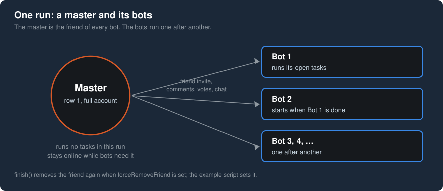
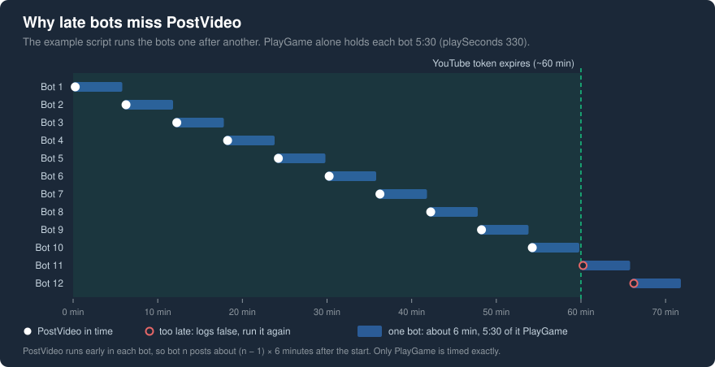

# How it works

Background reading: why a run needs a master, in which order the tasks run, what a run leaves on the
accounts, why five tasks are not automated and which limits Steam sets. To try it out, start with
[Getting started](getting-started.md).

## Sessions, not passwords

The library never sees a password. It works on a logged-in
[`steamcommunity`](https://www.npmjs.com/package/steamcommunity) instance per account, and for two tasks on a
logged-in [`steam-user`](https://www.npmjs.com/package/steam-user) client. Logging in is the job of the script
around it, such as [`examples/run-community-leader.js`](../examples/run-community-leader.js). So credentials
and tokens stay in code you control, and the library fits into any bot that already uses `steamcommunity`.

`steam-user` is optional for the same reason: only PlayGame and UseEmoticonInChat need a Steam client
connection. Without it those two tasks are skipped, and the run goes on.

## The master and the bots

Five tasks need a friend: adding one, commenting on the friend's profile, commenting on the friend's
screenshot, voting on the friend's activity and sending the friend an emoticon in chat. One account cannot do
them alone, so one of your accounts plays that friend for all others. That account is the **master**; the
accounts that run the tasks are the **bots**. Both are ordinary Steam accounts you own; the master is simply
the first one of the run.

The master has two more jobs:

- **It sends the friend invite.** Steam lets a limited account (less than 5 USD spent on Steam) accept friend
  invites but not send them. The master invites, the bot accepts. That is why the master must be a full
  account, while the bots may be limited.
- **It provides the screenshot.** The screenshot comment and the activity vote need a friend's screenshot.
  The run reads the master's newest screenshot once per process and uses it for every bot, so the master's
  newest screenshot has to be public.

In code, the master is `masterInstance`: the master's logged-in `steamcommunity` instance. One instance serves
all bots. Its session has to stay valid while the bots run. The example script logs the master off at the end;
if the master also trades or listens to Steam events in your own project, keep it logged in and log off only
the bots.

The master runs no tasks in that run: it is the friend, not a player. Its own tasks need a friend too, so they
run in another run where a different account is the master.

The example script sets `forceAddFriend` and `forceRemoveFriend`, so there the friendship lasts only as long
as a bot's run: the bot adds the master even when its AddFriendToFriendsList task is done, because the other
friend tasks need the friendship, and `finish()` removes it again. Without these options an existing
friendship is used as it is, and a new one stays.

A run can also do without a master: `friendSteamId` and `friendsScreenshotFileId` name a friend directly.
That friend then has to accept the invite, and a limited bot cannot send one at all.

## What a run does

Each bot runs through `start()` and then `finish()`:

1. **Find the friend.** With a master, the friend is the master, and the screenshot is the master's newest
   one.
2. **Read the open tasks.** The run asks Steam which tasks of the badge are still open, from the badge page
   or, when the account has a Web API key, through the Web API. When nothing is open, it calls `finish()` and
   ends here.
3. **Read the account limits.** Limited accounts, VAC bans and trade bans decide which tasks may run. When
   Steam does not answer this request, the account counts as full and unbanned.
4. **Run the open tasks, group by group:**
	1. the tasks that need no friend, such as the wishlist, the screenshot, the video and the group;
	2. the friend tasks. Adding the friend comes first in Steam's order, and `forceAddFriend` runs it even
	   when it is done, because the others need the friendship. The profile comment runs only when the
	   SetupSteamGuard task is done, because Steam allows profile comments only from accounts with Steam Guard;
	3. Trade, for full accounts without a trade ban; it is not implemented and logs `false`;
	4. CraftGameBadge, before the background task, because crafting can drop a profile background. The run
	   keeps the dropped background, because right after crafting Steam may not list it as owned yet;
	5. PlayGame, SetProfileBackground and FeatureBadgeOnProfile. The late place helps the featured badge:
	   Steam unlocks badge 2 only after 13 completed tasks, and every task done before it counts toward them;
	6. the tasks for full accounts: the screenshot comment and the game review, and the Workshop vote for
	   accounts without a VAC ban.

   Inside a group the tasks run in the order Steam lists them.
5. **Read the open tasks again** and log how many are left and how many were solved.
6. **`finish()`** removes the friend when `forceRemoveFriend` is set. The example script skips it after
   `ACCESS_DENIED`, so that bot keeps the master as friend until the next run removes it.

The second read in step 5 matters. A task that logs `OK` sent its requests successfully; whether Steam counts
it is Steam's decision, and only the badge tells. The read also makes a second run safe: it starts with the
tasks that are still open and leaves the others alone.

## What stays on the accounts

The tasks are real actions on real accounts. Most of them are undone right away, and Steam keeps the task as
completed: in a run in November 2026 the game review was deleted right after posting, and the RecommendGame
task still counted.

Posts, comments and memberships are undone again ([tasks](tasks.md) lists each). A cleanup that fails is not
logged, so a comment or a status can stay behind without a word in the log.

Kept on the account:

- the avatar, the profile background and the featured badge;
- the Workshop vote and the votes on the friend's screenshot and activity post;
- the chat message to the friend;
- the free license of the played game (Counter-Strike 2 by default);
- the friend, unless `forceRemoveFriend` is set;
- the badge crafted from a set of trading cards and the items it drops; the cards are used up;
- with `steamcommunity` 3.43 to 3.47, a Web API key for `localhost` when the account had none.

## Why five tasks are not automated

- **BuyOrSellOnMarket**: trading on the Community Market just for a task goes against the
  [Steam Subscriber Agreement](https://store.steampowered.com/subscriber_agreement/english/#4).
- **SetupSteamGuard, AddPhoneToAccount, AddTwoFactorToAccount**: they change the security of the account.
  That decision stays with the owner. Done by hand, they count like any other task.
- **Trade**: not implemented in the library. It needs
  [steam-tradeoffer-manager](https://www.npmjs.com/package/steam-tradeoffer-manager) and a trade partner. Accepting
  a gift counts.

That leaves 23 automated tasks out of 28.

## How far an account gets

Community Leader needs 27 tasks: all 23 automated ones and 4 of the 5 that stay with you. A full account with
everything provided stops at 23, Community Ambassador; the example script alone, without a YouTube token and
trading cards, reaches 20, Pillar of Community. Without a phone number, a bot needs the other four by hand:
Steam Guard, the mobile authenticator, a Market sale and a trade.

A limited account loses the game review, the Workshop vote and the screenshot comment, so it reaches at most

20. It cannot send trade offers, give items away or use the Market. It can accept an offer that only gives it
	items, and that is a trade too. So with Steam Guard, the mobile authenticator, a phone number and a received
	trade it ends at 24, Community Ambassador. With `steamcommunity` alone, a limited account completes only 11 tasks,
    too few for the 13 that unlock
	the badge, so FeatureBadgeOnProfile fails as well. For the same reason a new account without a friend and
	`steam-user` usually completes FeatureBadgeOnProfile only in a second run. The counts per setup, as a chart:
	[FAQ](faq.md#how-many-tasks-will-an-account-complete).

## Steam limits

Steam limits what one machine may do, and the library does no pacing of its own, so keep to these limits in
your script. These docs assume about 10 accounts. The [ArchiSteamFarm](https://github.com/JustArchiNET/ArchiSteamFarm)
documentation describes the
limits well:

- ASF suggests owning up to 10 Steam accounts in total, based on Valve's guidelines
  ([ASF FAQ: How many bots can I run](https://github.com/JustArchiNET/ArchiSteamFarm/wiki/FAQ#how-many-bots-can-i-run-with-asf)).
- Too many logins in a short time end in `RateLimitExceeded`. ASF waits 10 seconds between logins (`LoginLimiterDelay`),
  and `examples/run-community-leader.js` does the same
  ([ASF configuration: LoginLimiterDelay](https://github.com/JustArchiNET/ArchiSteamFarm/wiki/Configuration#loginlimiterdelay)).
- Steam's web services temporarily block an IP that sends too many requests. ASF keeps at least 300 ms
  between two requests to the same web service (`WebLimiterDelay`)
  ([ASF configuration: WebLimiterDelay](https://github.com/JustArchiNET/ArchiSteamFarm/wiki/Configuration#weblimiterdelay)).

The block comes in two forms. A burst of requests gets HTTP `429` from Steam, a rate limit for that IP.
Harder is the `ACCESS_DENIED` block: Steam's CDN (Akamai) answers `403 Access Denied`, and web requests from
the IP are blocked, the store included. A run cannot do anything useful from that IP until the block ends,
so `start()` stops at the first blocked request; requests during the block can make it last longer.

## Time

PlayGame plays for `playSeconds`, 330 by default, and the run waits for it, so each bot with an open PlayGame
task takes about 6 minutes. The example script runs the bots one after another and logs them in 10 seconds
apart, so eight accounts (a master and seven bots) take at least 40 minutes.

Steam lets only one session per account play at a time, so PlayGame stops a game that another session of the
account plays ([steam-user: playingState](https://github.com/DoctorMcKay/node-steam-user#playingstate)). For
accounts that already play in ArchiSteamFarm, a run without `steam-user` avoids that clash.

The same clock limits the YouTube token of PostVideo: it is valid for about one hour after linking, and Steam
only reads it, so one token serves every bot of a run that reaches PostVideo within that hour. With more bots,
run them in batches, see [How to get the YouTube cookie](how-to/get-the-youtube-cookie.md).
