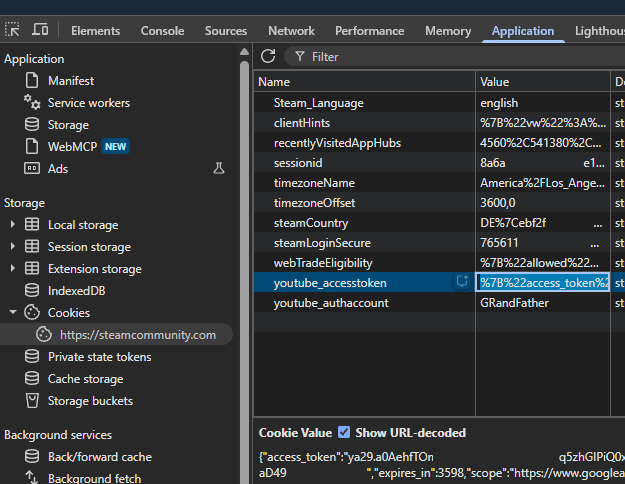

# How to get the YouTube cookie for PostVideo

This guide turns on the PostVideo task: it copies the `youtube_accesstoken` cookie from a browser and passes
it to the run.

## Before you start

- **The token works for about one hour** after you link YouTube. Copy it right before the run, not the day
  before.
- **Prepare the video first.** Sign in to the YouTube account you will link and make sure it has at least one
  uploaded video that is public or unlisted and allows embedding. Steam shares one of them for the task and
  deletes the share again.
- **With many accounts, not every bot makes it in one run.** Each bot takes about 6 minutes, so with more than
  about 10 bots the last ones reach PostVideo after the token expired, see the
  [timeline](../how-it-works.md#time). Run again with a fresh token: the run only does the tasks that are still
  open, so the second run repeats PostVideo for those bots and nothing else they finished.

## Copy the cookie

Do this in a browser where any of your Steam accounts is logged in:

1. Open <https://steamcommunity.com/my/videos/link> and click **Access your YouTube videos**.
2. Choose your Google account; Steam shows "Successfully linked your YouTube account".
3. On that steamcommunity.com tab open the developer tools (F12) → **Application** → **Cookies** →
   **https://steamcommunity.com** and copy the **Value** of `youtube_accesstoken` as the table shows it (it starts
   with `%7B%22access_token`). The cookie is `HttpOnly`, so a script in the console cannot read it.

   

## Pass it to the run

With `examples/run-community-leader.js`, put it into the `YT_ACCESS_TOKEN` environment variable:

```bash
YT_ACCESS_TOKEN='<value>' node run-community-leader.js accounts.csv
```

In your own code, pass it as an option:

```javascript
const unlocker = new SteamBadgeUnlocker(bot.community);
const leader = unlocker.createCommunityLeader({
	masterInstance: masterCommunity,
	youtubeCookies: {accessToken: '<value>'},
});
```

The same value serves every account of the run.

## Check the result

Look for the PostVideo line of each bot:

- `PostVideo OK`: done.
- `PostVideo false`: Steam listed no video. Either the value had expired by the time this bot ran, or the
  YouTube account has no video that allows embedding. Copy a fresh value and run the accounts that logged
  `false` again.
- `PostVideo INVALID_YOUTUBE_ACCESS_TOKEN` (with `youtubeId` set): Steam did not accept the value. Link
  YouTube again and copy a fresh one.
- `PostVideo SKIP_MISSING_YOUTUBE_ACCESS_TOKEN`: the run got no value; check the variable name or the option.

To run the bots in batches with a fresh value for each batch, write one accounts file per batch, each with the
master in the first row, see [How to run the quests for all your accounts](run-all-your-accounts.md).

To turn PostVideo off again, leave `youtubeCookies` out: the task is skipped before any request.
